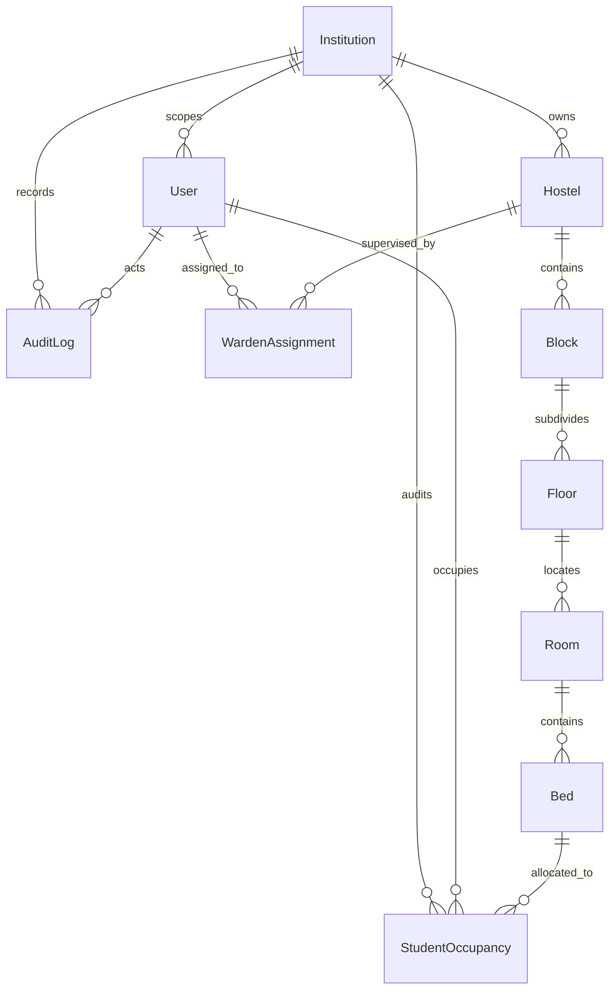

# RoomLoop Database Schema & Entity Relationships

This document outlines the relational data models, field definitions, unique constraints, and database-level integrity rules implemented in **RoomLoop Phase 1**.

---

## 1. Entity Relationship Overview

---

## 2. Table Specifications

### `core_institutions`
Represents the university or educational governing body. All domain inventory and users are strictly scoped under an institution.

| Column | Type | Constraints | Description |
|---|---|---|---|
| `id` | BigAutoField | PRIMARY KEY | Unique surrogate identifier |
| `name` | VARCHAR(255) | NOT NULL | Official institution title |
| `code` | VARCHAR(50) | UNIQUE, INDEX | Unique institution code (e.g. `DEMO-UNIV`) |
| `address` | VARCHAR(500) | | Physical campus address |
| `city` | VARCHAR(100) | | City location |
| `state` | VARCHAR(100) | | State / Province |
| `contact_email`| VARCHAR(254) | NOT NULL | Official administrative contact |
| `is_active` | BOOLEAN | DEFAULT TRUE | Operational status flag |
| `created_at` | TIMESTAMPTZ | AUTO_NOW_ADD | Creation audit timestamp |
| `updated_at` | TIMESTAMPTZ | AUTO_NOW | Update timestamp |

---

### `accounts_users`
Custom user model extending `AbstractBaseUser` and `PermissionsMixin`.

| Column | Type | Constraints | Description |
|---|---|---|---|
| `id` | UUID | PRIMARY KEY | Cryptographically random UUID |
| `email` | VARCHAR(255) | UNIQUE, INDEX | Normalized login identity |
| `full_name` | VARCHAR(255) | NOT NULL | Student or staff full name |
| `institution_id` | BIGINT | FK -> `core_institutions` | Owning educational institution |
| `registration_number`| VARCHAR(50) | INDEX | Student roll / registration number |
| `phone_number` | VARCHAR(20) | | Primary contact phone |
| `account_status` | VARCHAR(20) | DEFAULT 'active' | Choices: `active`, `pending`, `suspended` |
| `is_staff` | BOOLEAN | DEFAULT FALSE | Staff / Admin portal access |
| `is_active` | BOOLEAN | DEFAULT TRUE | User account active flag |
| `date_joined` | TIMESTAMPTZ | NOT NULL | Registration date |

**Constraints:**
- `unique_registration_per_institution`: Conditional unique constraint ensuring `registration_number` is unique per institution when non-null.

---

### `hostels_hostels`
Residential hostels / dormitories on campus.

| Column | Type | Constraints | Description |
|---|---|---|---|
| `id` | BigAutoField | PRIMARY KEY | Unique surrogate ID |
| `institution_id` | BIGINT | FK -> `core_institutions` | Owning institution |
| `name` | VARCHAR(255) | NOT NULL | Hostel title (e.g. `North Residence`) |
| `code` | VARCHAR(50) | INDEX | Unique code (e.g. `NR-01`) |
| `resident_category`| VARCHAR(50) | NOT NULL | `male`, `female`, `postgraduate`, `coed` |
| `address` | VARCHAR(500) | | Campus quadrant / location |
| `description` | TEXT | | Facilities and notes |
| `status` | VARCHAR(30) | DEFAULT 'active' | `active`, `maintenance`, `inactive` |

**Constraints:**
- `unique_hostel_code_per_institution`: `UNIQUE (institution_id, code)`

---

### `hostels_blocks`
Wings, blocks, or towers within a hostel.

| Column | Type | Constraints | Description |
|---|---|---|---|
| `id` | BigAutoField | PRIMARY KEY | Unique block ID |
| `hostel_id` | BIGINT | FK -> `hostels_hostels` | Parent hostel |
| `name` | VARCHAR(100) | NOT NULL | Block name (e.g. `Block A`) |
| `code` | VARCHAR(50) | NOT NULL | Block code (e.g. `BLK-A`) |

**Constraints:**
- `unique_block_code_per_hostel`: `UNIQUE (hostel_id, code)`

---

### `hostels_floors`
Floor levels inside a residential block.

| Column | Type | Constraints | Description |
|---|---|---|---|
| `id` | BigAutoField | PRIMARY KEY | Unique floor ID |
| `block_id` | BIGINT | FK -> `hostels_blocks` | Parent block |
| `floor_number` | INTEGER | NOT NULL | Numeric level (e.g. `0`, `1`, `2`) |
| `floor_label` | VARCHAR(100) | NOT NULL | Label (e.g. `Ground Floor`, `1st Floor`) |

**Constraints:**
- `unique_floor_number_per_block`: `UNIQUE (block_id, floor_number)`

---

### `hostels_rooms`
Physical room units on each floor.

| Column | Type | Constraints | Description |
|---|---|---|---|
| `id` | BigAutoField | PRIMARY KEY | Unique room ID |
| `floor_id` | BIGINT | FK -> `hostels_floors` | Parent floor |
| `room_number` | VARCHAR(50) | NOT NULL, INDEX | Room number (e.g. `101`, `204`) |
| `room_type` | VARCHAR(20) | NOT NULL | `single`, `double`, `triple`, `four` |
| `occupancy_category`| VARCHAR(100)| DEFAULT 'Standard' | e.g. `Standard`, `AC`, `Attached Bath` |
| `operational_status`| VARCHAR(30)| DEFAULT 'in_service' | `in_service`, `maintenance`, `out_of_service` |

**Constraints:**
- `unique_room_number_per_floor`: `UNIQUE (floor_id, room_number)`

---

### `hostels_beds`
Individual bed slots inside each room.

| Column | Type | Constraints | Description |
|---|---|---|---|
| `id` | BigAutoField | PRIMARY KEY | Unique bed ID |
| `room_id` | BIGINT | FK -> `hostels_rooms` | Parent room |
| `bed_label` | VARCHAR(50) | NOT NULL | Identifier (e.g. `Bed A`, `Bed B`) |
| `operational_status`| VARCHAR(30)| DEFAULT 'in_service' | `in_service`, `maintenance`, `out_of_service` |

**Constraints:**
- `unique_bed_label_per_room`: `UNIQUE (room_id, bed_label)`

---

### `hostels_warden_assignments`
Assigns staff wardens to one or more hostels.

| Column | Type | Constraints | Description |
|---|---|---|---|
| `id` | BigAutoField | PRIMARY KEY | Surrogate ID |
| `warden_id` | UUID | FK -> `accounts_users` | Assigned staff user |
| `hostel_id` | BIGINT | FK -> `hostels_hostels` | Supervised hostel |
| `is_primary` | BOOLEAN | DEFAULT FALSE | Chief / primary warden flag |

**Constraints:**
- `unique_warden_per_hostel`: `UNIQUE (warden_id, hostel_id)`

---

### `hostels_student_occupancies`
Core transactional ledger recording student-to-bed allocation lifecycle.

| Column | Type | Constraints | Description |
|---|---|---|---|
| `id` | BigAutoField | PRIMARY KEY | Surrogate allocation ID |
| `institution_id` | BIGINT | FK -> `core_institutions`| Institution scope |
| `student_id` | UUID | FK -> `accounts_users` | Allocated student |
| `bed_id` | BIGINT | FK -> `hostels_beds` | Allocated bed slot |
| `start_date` | DATE | NOT NULL, INDEX | Effective check-in date |
| `end_date` | DATE | NULL, INDEX | Release / check-out date |
| `status` | VARCHAR(30) | DEFAULT 'active' | `active`, `transferred`, `released`, `cancelled` |
| `source` | VARCHAR(30) | NOT NULL | `administrative`, `direct_swap`, `multi_swap`, `seed` |
| `created_by_id` | UUID | FK -> `accounts_users` | Staff member who authorized allocation |
| `release_reason` | TEXT | | Mandatory audit reason on release |

**Database Constraints & Indexes:**
1. `unique_active_occupancy_per_student`: Conditional unique constraint on `(student_id)` where `status = 'active'`. Ensures a student can NEVER hold more than one active bed.
2. `unique_active_occupancy_per_bed`: Conditional unique constraint on `(bed_id)` where `status = 'active'`. Guarantees a bed slot can NEVER have two active occupants.
3. `occupancy_end_date_gte_start_date`: Check constraint verifying `end_date IS NULL OR end_date >= start_date`.
4. Composite indexes on `(status, student_id)`, `(status, bed_id)`, and `(institution_id, status)`.

---

### `core_audit_logs`
Immutable operational audit trail.

| Column | Type | Description |
|---|---|---|
| `id` | BigAutoField | Surrogate audit ID |
| `acting_user_id` | UUID | Acting user |
| `institution_id` | BIGINT | Institution context |
| `action` | VARCHAR(100) | `USER_CREATED`, `HOSTEL_CREATED`, `OCCUPANCY_ASSIGNED`, `OCCUPANCY_RELEASED`, etc. |
| `target_type` | VARCHAR(100) | Entity model name |
| `target_id` | VARCHAR(100) | Entity identifier |
| `timestamp` | TIMESTAMPTZ | Automatic creation time |
| `change_summary` | TEXT | Human-readable diff summary |
| `ip_address` | INET | Client IP address |
