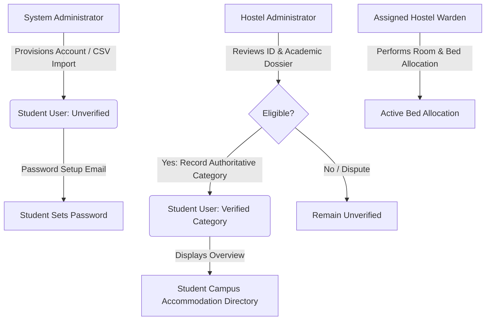

# Student Account Management & Residential Verification

RoomLoop implements an end-to-end, role-governed student provisioning and verification workflow. The architecture enforces strict separation of concerns across administrators, wardens, and students.

---

## 1. Governance & Role Separation Workflow



### Core Invariants:
1. **Account Creation Never Allocates Accommodation:**
   Creating or updating a student account creates their identity and authentication credentials with `residential_eligibility = "unverified"`. No bed, room, or hostel is ever allocated during account provisioning.
2. **Claimed Category ≠ Verified Eligibility:**
   A student's claimed residential preference is an unverified request. Only the **Hostel Administrator** has authority to record verified residential eligibility (`male` or `female`).
3. **Warden Allocation Role Boundary:**
   Assigned hostel wardens can only allocate vacant beds in their assigned hostels to students whose verified residential eligibility matches the hostel category. Wardens cannot allocate unverified students.
4. **Safety Invariants:**
   - Attempting to modify a student's verified eligibility while they hold an active bed allocation in a conflicting hostel is blocked server-side until the assigned warden releases the current room.
   - Modifying eligibility while open/pending exchange requests exist is blocked until requests are resolved.
   - Deactivating a student blocks future logins but does *not* automatically vacate or release their room allocation; a warning is presented requiring warden room release.

---

## 2. System Administrator: Creating a Student Account

### Manual Single Student Creation
1. Sign in as **System Administrator** (`sysadmin@apex.edu` or institutional equivalent).
2. In the left navigation sidebar, locate the **Students** section and select **Add Student** (`/accounts/students/add/`).
3. Enter the student's details:
   - **Full Legal Name** (min. 2 characters)
   - **Roll / Registration Number** (unique within the institution)
   - **Institutional Email Address** (unique within the institution)
   - **Department / Branch** (e.g. *Computer Science & Engineering*)
   - **Degree / Academic Program** (e.g. *B.Tech*)
   - **Cohort / Year of Study** (*1st Year, 2nd Year, etc.*)
   - **Contact Phone Number**
   - **Initial Claimed Residential Category** (*Boys' Hostel, Girls' Hostel, or Unspecified*)
4. Click **Create Student & Dispatch Password Setup**.
5. The platform:
   - Associates the student strictly with the administrator's institution.
   - Forces the role to **Student** (`is_staff=False`, `is_superuser=False`).
   - Sets an initial unusable password.
   - Dispatches a secure, single-use password setup link to the student's email.
   - Records an immutable `STUDENT_CREATED` event in the audit trail.

---

## 3. System Administrator: Bulk CSV Import

### Import Process
1. Navigate to **Students &rarr; Import Students** (`/accounts/students/import/`).
2. Download the standardized CSV template via **Download CSV Template** (`/accounts/students/import/template/`).
3. Prepare the CSV file with the following headers:
   ```csv
   full_name,registration_number,email,department,program,academic_year,phone_number,claimed_residential_category
   Aarav Sharma,2024CS101,aarav.sharma@apex.edu,Computer Science & Engineering,B.Tech,1st Year,+91 9876543210,male
   Priya Patel,2024EE205,priya.patel@apex.edu,Electrical Engineering,B.Tech,1st Year,+91 9876543211,female
   ```
4. Upload the UTF-8 encoded `.csv` file (maximum 500 rows, 2MB limit).
5. **Two-Stage Validation & Preview:**
   - The server parses and validates all rows against database constraints and in-file duplicate checks **without writing to the database**.
   - Review the summary metrics: *Total Rows, Ready to Create, Duplicate Rows, Errors Found*.
   - Inspect individual tables for valid rows, flagged duplicates, and formatted errors.
6. Click **Confirm & Provision Students** to commit valid records transactionally.
7. Retrying an import with existing records cleanly skips duplicates without creating duplicate accounts.

---

## 4. Hostel Administrator: Residential Eligibility Verification

### Review & Verification Queue
1. Sign in as **Hostel Administrator** (`hostel.admin@apex.edu`).
2. In the left navigation sidebar, click **Eligibility Verification** (`/accounts/eligibility-verification/`).
   - A badge displays the number of active students awaiting verification in real time.
3. Search and filter by student name, roll number, claimed category, or department.
4. Click **Review & Verify &rarr;** on a candidate student.
5. In the verification interface:
   - Review academic details, degree program, and the student's claimed residential category.
   - Inspect active accommodation and past verification trail.
   - Select the authoritative category:
     * `Verified Male Accommodation` (Boys' Hostels)
     * `Verified Female Accommodation` (Girls' Hostels)
     * `Pending Institutional Verification` (Unverified / On-Hold)
   - Enter a mandatory **Verification Reason & Justification** (minimum 5 characters, e.g., *"Verified physical government ID, admission dossier, and biometric check-in confirmation"*).
6. Click **Record Authoritative Verification**.
7. An immutable `EligibilityVerificationRecord` and `ELIGIBILITY_VERIFIED` audit log are committed.

---

## 5. Testing Student Resulting Access

### Phase A: Unverified Student (Pending Verification)
1. Complete first-time password setup by opening the dispatched link `/accounts/password-setup/<uidb64>/<token>/` and choosing a password.
2. Sign in as the student at `/accounts/login/`.
3. You will be redirected to the **Student Dashboard** (`/dashboard/student/`):
   - A prominent notice displays: **"Residential Eligibility Verification Pending — Under Review"**.
   - Account credentials and registration details are displayed for verification.
   - "Start Exchange Request" is hidden or disabled.
   - Self-service room allocation is blocked.

### Phase B: Verified Student
1. Once the **Hostel Administrator** verifies eligibility as *Verified Male* or *Verified Female*:
2. Refresh the **Student Dashboard**:
   - The pending banner is replaced with a **Verified Eligibility** status badge.
   - An **Eligible Campus Accommodation Overview** appears, displaying all university hostels matching their verified resident category with total room/bed capacities.
   - Notice reminds the student: *"Specific room allocation remains the responsibility of your assigned hostel warden."*
3. The assigned **Hostel Warden** can now locate the verified student in **Occupancy Roster &rarr; Assign Bed** (`/hostels/occupancy/assign/`) and allocate them to a vacant bed.
